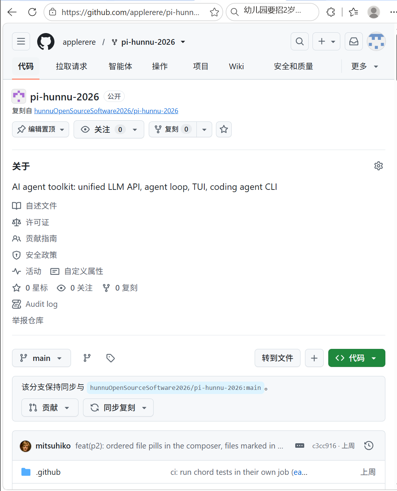
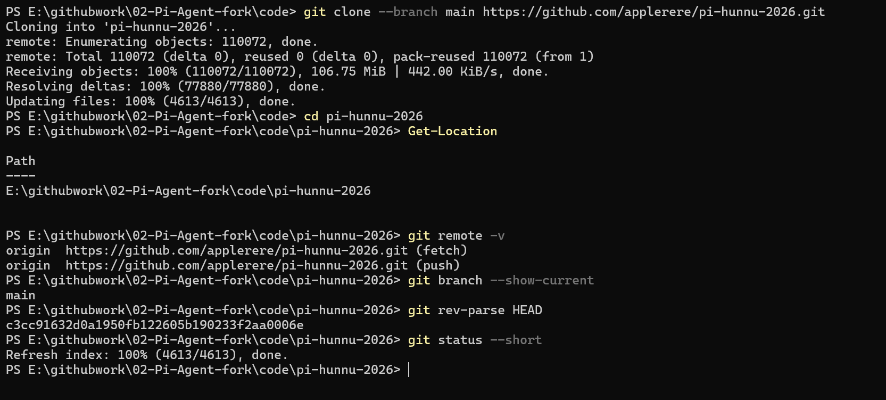
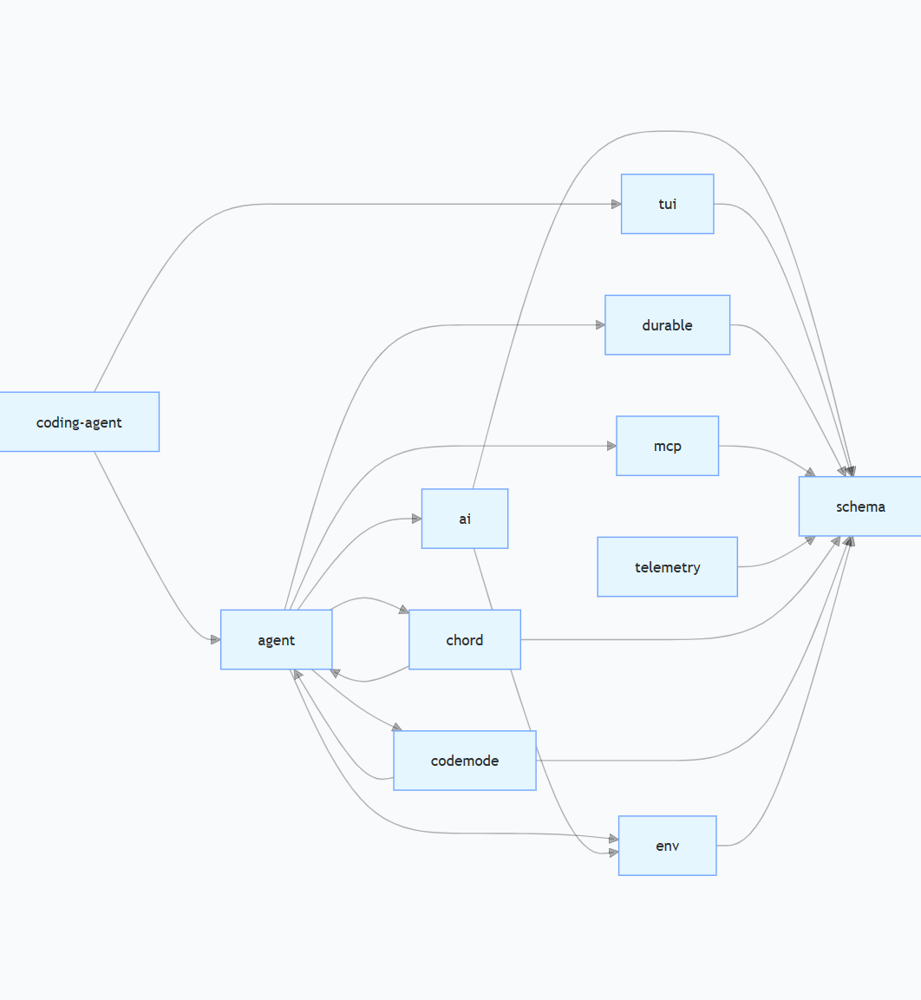

# Pi Agent 实训报告
## 源码获取
1. 组织仓库页面截图

2. 本人 clone 后的仓库信息（S1）

- 本地目录：`E:\githubwork\02-Pi-Agent-fork\code\pi-hunnu-2026`
- 远端仓库地址：`https://github.com/applerere/pi-hunnu-2026.git`
- 当前分支：`main`
- 提交哈希：`c3cc91632d0a1950fb122605b190233f2aa0006e`

3. 源码目录截图

## 模块分析
### 1. 构建顺序
schema → env → ai → telemetry → durable → mcp → tui → agent → chord → codemode → coding-agent

### 2. 模块分析表
| 子文件夹 | 代码主要实现什么功能 | 本模块 build 执行什么、生成什么 | 直接依赖哪些内部模块 | 依据文件或代码位置 |
|---|---|---|---|---|
| `telemetry` |实现遥测、运行日志、事件埋点采集，记录程序运行指标，用于观测与调试|执行 TS 类型编译，输出 ESM/CommonJS 模块产物，导出遥测上报工具|schema|`packages/telemetry/package.json`、`src/index.ts`|
| `schema` |定义项目全局 TS 类型、会话、消息、工具参数的数据结构与校验规则|编译生成类型声明文件`.d.ts`，提供全项目统一数据契约|无内部依赖|`packages/schema/package.json`、`src/schema`|
| `chord` |子代理编排，负责复杂任务拆分、多个子 Agent 协同调度、任务流转管理|TS 编译，导出任务编排、子代理调度相关 API|`agent`、`schema`|`packages/chord/package.json`、`src/orchestrator`|
| `tui` |终端交互式 UI 组件库，渲染对话界面、输入组件、加载动画，提供终端交互能力|TS 编译，导出终端渲染组件、布局工具函数|`schema`|`packages/tui/package.json`、`src/components`|
| `codemode` |代码编辑模式，处理文件读写、代码变更 diff 展示、代码块提交修改逻辑|TS 编译，导出文件操作、代码变更处理接口|`agent`、`schema`、`durable`|`packages/codemode/package.json`、`src/code-mode`|
| `mcp` |MCP 工具协议封装，标准化外部工具调用、参数解析、返回结果处理|TS 编译，实现 MCP 协议客户端，导出工具调用能力|`schema`|`packages/mcp/package.json`、`src/mcp-client`|
| `ai` |大模型统一抽象层，封装不同 LLM 服务商接口、请求组装、响应解析、模型调用|TS 编译，导出模型调用抽象接口与 Provider|`schema`、`env`|`packages/ai/package.json`、`src/providers`|
| `durable` |会话持久化管理，实现会话快照保存、断点恢复、上下文持久存储|TS 编译，导出会话读写、持久化存储 API|`schema`、`env`|`packages/durable/package.json`、`src/store`|
| `env` |环境配置管理，读取环境变量、密钥加载、配置项校验|TS 编译，导出配置加载、读取工具函数|`schema`|`packages/env/package.json`、`src/config`|
| `agent` |Agent 核心主循环，消息流转、工具调度、会话状态维护、插件扩展加载|TS 编译，输出 Agent 核心引擎、上下文管理、工具调度 API|`ai`、`schema`、`env`、`durable`、`mcp`、`chord`|`packages/agent/package.json`、`src/agent-loop`|
| `coding-agent` |CLI 入口程序，提供`pi`命令，解析命令行参数，拉起 TUI 交互会话，调用 Agent 核心|TS 编译打包，输出可执行 CLI 程序|`agent`、`tui`、`schema`、`env`|`packages/coding-agent/package.json`、`src/cli`|

### 3. 依赖关系图

### 4. 问题回答
a根目录与子模块中的 npm run build 分别读取什么配置、执行什么工作？
根目录 build 读取`turbo.json`、`pnpm-workspace.yaml`，按依赖拓扑批量调度所有子模块构建；子模块 build 读取本地`tsconfig.json`、`package.json`，仅编译自身源码，生成 JS 和类型声明。

b构建顺序和模块依赖有什么关系？相邻构建的模块是否一定互相依赖？
构建顺序是依赖图的拓扑排序，被依赖模块优先构建。**相邻模块不一定互相依赖**，只是排序位置邻近。

c选择一条涉及至少三个模块的依赖路径，说明这些模块如何分工。
**schema → env → ai → agent**
schema：统一数据类型定义；env：加载密钥与配置；ai：封装大模型调用；agent：依托模型能力运行 Agent 主循环、调度工具，逐层提供能力。
