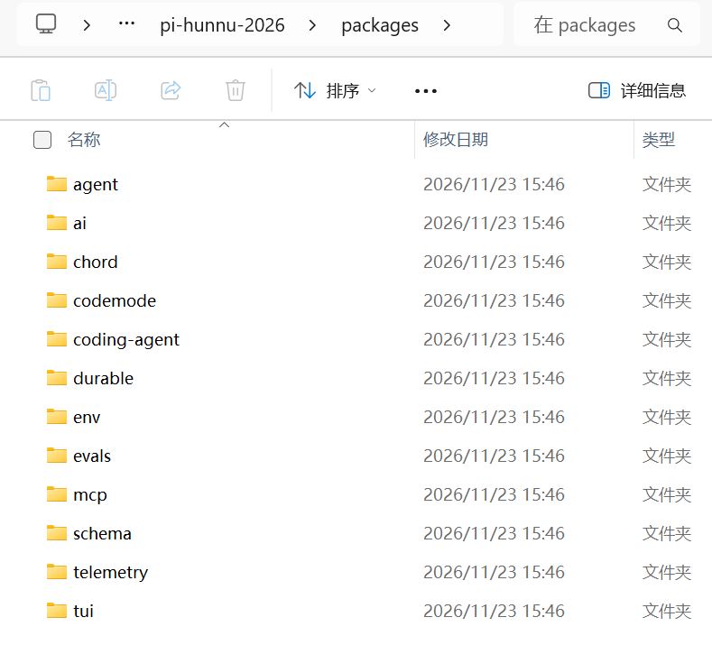

# Pi Agent 实训报告
## 源码获取
1. 组织仓库页面截图


2. 本人 clone 后的仓库信息（S1）

- 本地目录：`E:\githubwork\02-Pi-Agent-fork\code\pi-hunnu-2026`
- 远端仓库地址：`https://github.com/applerere/pi-hunnu-2026.git`
- 当前分支：`main`
- 提交哈希：`c3cc91632d0a1950fb122605b190233f2aa0006e`

3. 源码目录截图


> Issue 粘贴文本URL：
> https://github.com/applerere/pi-hunnu-2026.git

## 模块分析
### 1. 构建顺序
`pi-ai` → `pi-agent-core(agent)` → `pi-tui` → `pi-coding-agent`
其余辅助包（chord、codemode、durable、env、evals、mcp、schema、telemetry）按需跟随核心包构建。
理由：
- `ai`：底层大模型抽象层，无内部依赖，最先构建；
- `agent`：Agent核心运行时，依赖 ai；
- `tui`：终端UI组件包，独立；
- `coding-agent`：CLI入口，依赖 agent、tui，最后构建。

### 2. 模块分析表
| 子文件夹 | 代码主要实现什么功能 | 本模块 build 执行什么、生成什么 | 直接依赖哪些内部模块 | 依据文件或代码位置 |
|---|---|---|---|---|
| `telemetry` |实现遥测、运行日志、事件埋点采集，记录程序运行指标，用于观测与调试|执行 TS 类型编译，输出 ESM/CommonJS 模块产物，导出遥测上报工具|schema|`packages/telemetry/package.json`、`src/index.ts`|
| `schema` | 待分析 | 待分析 | 待分析 | 待填写 |
| `chord` | 待分析 | 待分析 | 待分析 | 待填写 |
| `tui` | 待分析 | 待分析 | 待分析 | 待填写 |
| `codemode` | 待分析 | 待分析 | 待分析 | 待填写 |
| `mcp` | 待分析 | 待分析 | 待分析 | 待填写 |
| `ai` | 待分析 | 待分析 | 待分析 | 待填写 |
| `durable` | 待分析 | 待分析 | 待分析 | 待填写 |
| `env` | 待分析 | 待分析 | 待分析 | 待填写 |
| `agent` | 待分析 | 待分析 | 待分析 | 待填写 |
| `coding-agent` | 待分析 | 待分析 | 待分析 | 待填写 |

### 3. 依赖关系图
```mermaid
graph LR
    A[coding-agent] --> B[agent]
    A --> C[tui]
    B --> D[ai]
    B --> E[chord]
    B --> F[codemode]
    B --> G[durable]
    B --> H[env]
    B --> I[mcp]
    J[evals] --> B
