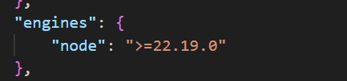

# Pi 本地源码编译与运行实验报告

## 1. Node.js 版本要求在哪里？
Node.js 版本要求写在仓库**根目录 package.json 的 engines 字段**，要求 node 版本 ≥ 22.19.0。

## 2. npm run build 实际从哪里读取命令？
`npm run build` 先读取**根 package.json 中 `scripts.build` 的命令**；该脚本会按顺序进入各个子包目录，调用每个子包自己 package.json 里定义的 build 脚本，各子包的编译逻辑由子包配置决定。

## 3. 源码入口与打包入口对比
### （1）如何确保运行的是本地源码
使用 `.\pi-test.bat` 作为启动入口，该脚本直接加载项目内 `packages/coding-agent/src` 下的 TypeScript 源码，不会读取 `dist` 目录下编译打包后的文件；启动前通过 `.\pi-test.bat --version` 验证版本，同时该启动方式不依赖预先编译产物，以此确认运行的是本地源码。

### （2）源码入口 `.\pi-test.bat` 适用场景
适合开发调试场景：修改 TS 源码后，不需要执行完整打包编译流程，可直接加载源码运行，方便快速验证代码改动、调试新功能、排查 bug，是开发阶段使用的入口。

### （3）dist 打包入口 `node .\packages\coding-agent\dist\bundle\cli.js` 适用场景
适合正式发布、部署交付场景：它是源码经过编译、打包之后生成的独立 JS 产物，不再依赖原始 TS 源码，环境只需要 Node 即可运行，用于给使用者分发、线上部署，不适合频繁改代码调试。
