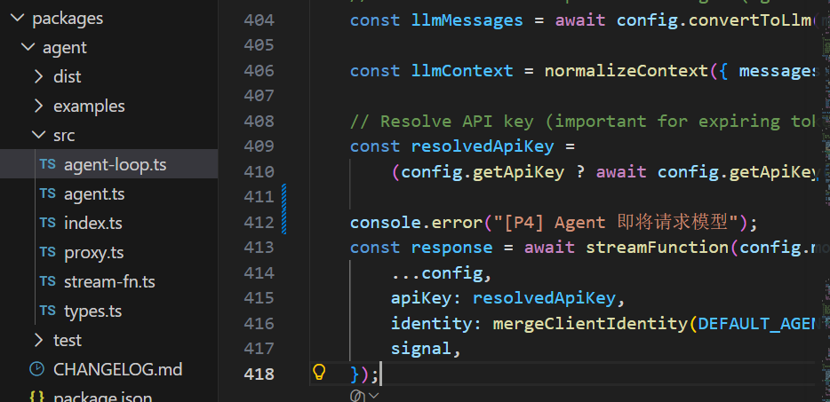
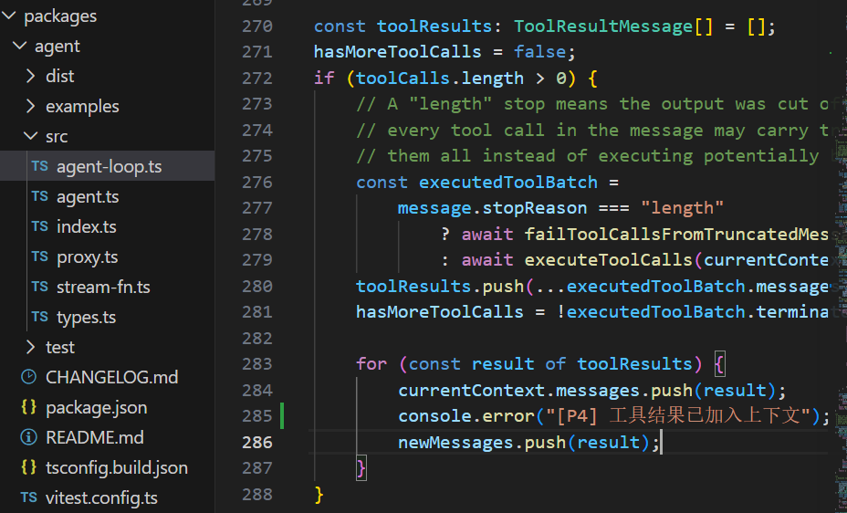
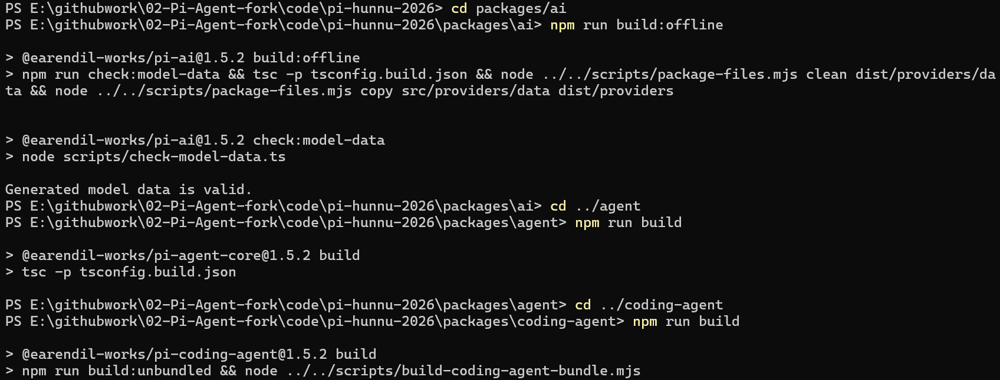
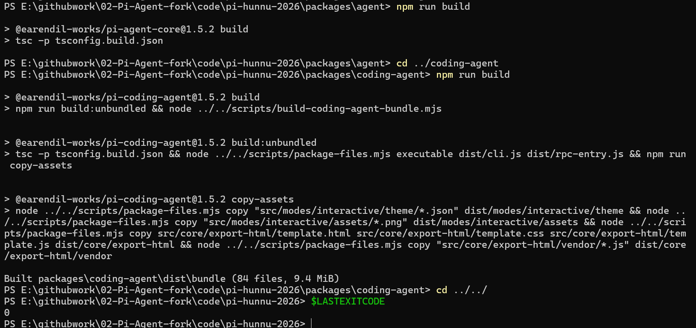
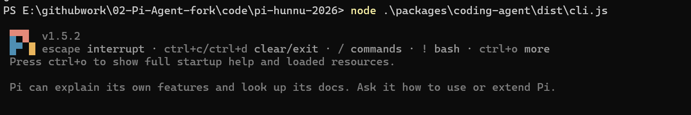
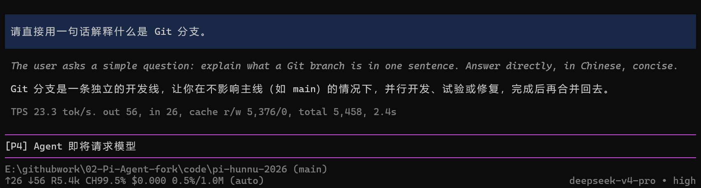
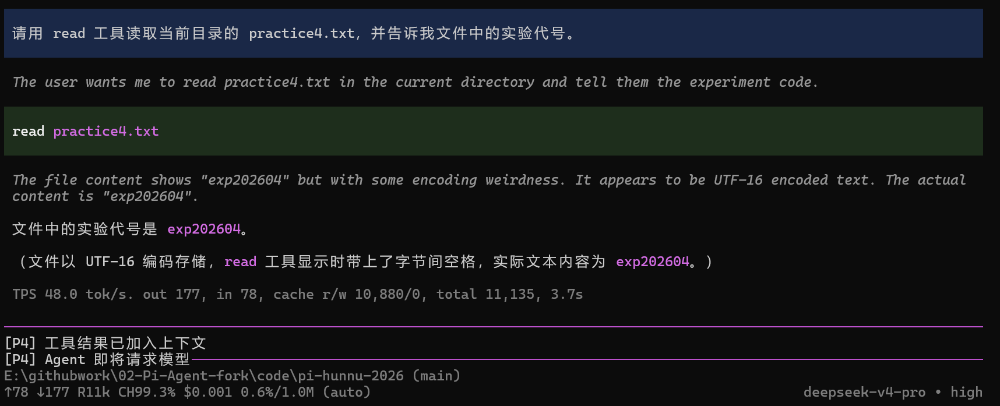
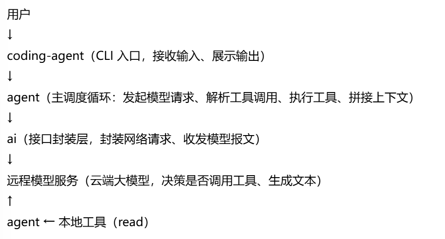

# 实践课4：Pi Agent模型调用与运行流程
## 1. 源码修改
本次在代码中添加两处P4日志打印，用于观测Agent执行流程：
- 位置1：Agent准备向大模型发起请求前，打印 `[P4] Agent 即将请求模型`

- 位置2：工具执行完成、工具返回结果并入上下文之后，打印 `[P4] 工具结果已加入上下文`

## 2. 运行证据
1. 重新编译、启动Pi Agent的终端日志：

备注：根目录直接执行`npm run build`会在`generate-models`阶段联网拉取 models.dev，受网络限制超时失败。本次实验单独编译 ai、agent、coding-agent 核心包，实现等价构建，构建完成后`$LASTEXITCODE`返回 0，代表构建成功。

3. 会话A（直接问答）运行截图：
4. 会话B（read读取文件）运行截图：

## 3. 运行流程
### 会话A（直接问答）
- 输入指令：请直接用一句话解释什么是 Git 分支。
- 是否调用工具：否
- 观测到的 [P4] 日志顺序：[P4] Agent 即将请求模型
- 最终回复：Git分支是一条独立的开发线，让你在不影响主线（如main）的情况下，并行开发、试验或修复，完成后再合并回去。
- 模型调用轮数：**1轮**
说明：该问题不需要访问本地资源、调用工具。Agent直接把用户问题提交给大模型，模型直接生成答案，一轮模型调用后交互结束。

### 会话B（读取文件）
- 输入指令：请用 read 工具读取当前目录的 practice4.txt，并告诉我文件中的实验代号。
- 是否调用工具：是（调用read工具）
- 截图中可见 [P4] 日志：
[P4] 工具结果已加入上下文
[P4] Agent 即将请求模型
- 最终回复：文件中的实验代号是 exp202604。（文件以 UTF-16 编码存储，read 工具显示时带上了字节间空格，实际文本内容为 exp202604。）
- 模型调用轮数：**2轮**

#### 问题回答
1. **谁实际读了文件？**
本地 `read` 工具读取磁盘上的 practice4.txt 文件。大模型本身无法直接访问本地磁盘文件，文件读取是本地工具的行为，由agent调度触发。
2. **下一轮模型请求多带了什么？**
第二轮向远程模型发起请求时，上下文额外携带了 **read工具读取得到的文件内容（工具返回结果）**，模型结合原始提问和文件内容生成最终回复。

### 组件关系简图

- coding-agent：命令行入口，用户交互入口
- agent：核心调度循环，控制整个Agent运行流程
- ai：模型接口封装，隔离底层网络细节
- 远程模型服务：云端大模型，负责推理、输出工具调用指令或者回答文本

### 对比小结
会话A不需要工具，仅一轮模型调用，模型直接给出回答；
会话B需要读取本地文件，分为两轮：第一轮模型输出调用read工具的指令 → 本地执行read获取文件内容并合并进上下文 → 第二轮带上工具返回结果再次请求模型，生成最终答案。

## 4. 实验总结
Agent会根据模型返回结果判断是否调用本地工具。无工具依赖的任务一轮调用完成；需要工具的任务会形成多轮交互：模型决策调用工具 → 本地执行工具 → 工具结果回填上下文 → 再次请求模型得到最终回答。
本地文件读写由本地工具完成，大模型不能直接访问本机磁盘。
