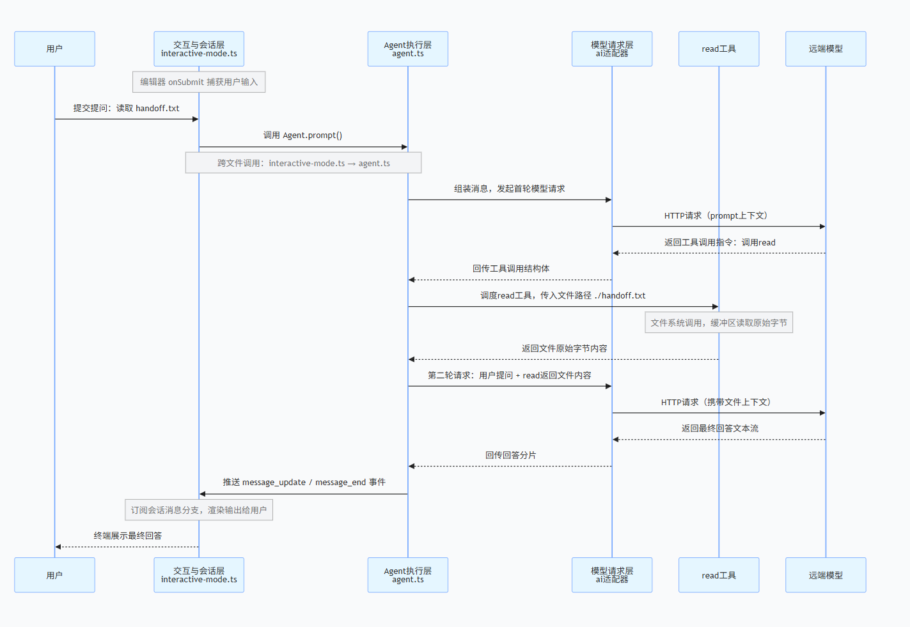
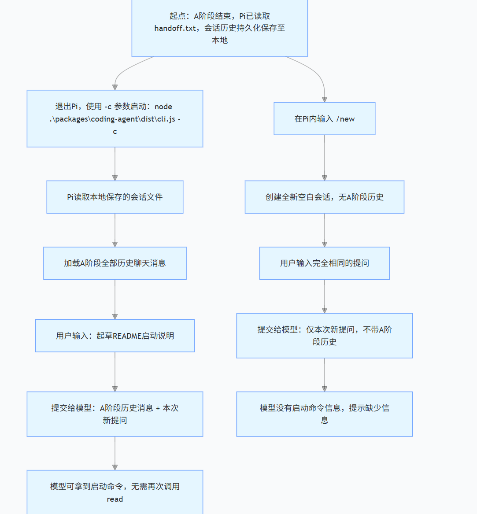

# 实践 05｜Pi Agent 源码泛读与功能定位

## A. 单轮交互与工具调用（复用实践 04）

图 1 说明：
1. 五条生命线：用户、交互与会话层（`interactive-mode.ts`）、Agent 执行层（`agent.ts`）、模型请求层（ai 适配器）、read 工具；
2. 输入入口：`interactive-mode.ts` 的编辑器回调 `onSubmit`，捕获回车提交的提问；
3. 交互层跨文件调用 `agent.ts` 的 `Agent.prompt()`，启动 Agent 主循环；
4. 模型请求层作为边界：ai 适配器负责封装 HTTP 请求、解析远端模型返回报文；
5. read 工具执行本地文件缓冲区读取，直接返回原始字节，**不自动处理文本编码**（本次实验中文件为 UTF-16LE 编码，原始字节出现乱码，由模型识别编码后还原文本）；
6. 模型流式返回内容，Agent 持续推送 `message_update` 分片事件，全部接收完成后触发 `message_end`；交互层订阅该事件，把内容打印到终端，也就是用户看到输出的位置。

## B.恢复上次会话，继续写 README

图 2 说明：
起点为 A 交互完成，会话历史已经保存到本地磁盘，分为两条分支：
1. 左分支（`-c`恢复会话）：带`-c`参数启动 Pi，读取持久化会话文件、恢复全部历史记录；请求模型时，历史消息和新提问一起传入，模型可以复用之前读到的启动命令。
2. 右分支（`/new`新建会话）：在 Pi 中执行`/new`，开辟独立空会话，历史隔离；请求模型时只有当前这句提问，没有 A 阶段读取文件的上下文，模型不知道启动命令。
