# Pi Agent 安装与基础使用实验报告

## 基本信息与实验目标
- 姓名：潘雷
- 学号：202430224101
- GitHub用户名：PL666pl
- 个人仓库：https://github.com/PL666pl/homework

本次实验完成Pi Agent客户端本地部署，依次完成模型配置、模型与思考级别切换、代码文件引用、图片多模态输入、扩展插件安装使用、Skill部署调用，掌握Pi Agent交互使用与扩展机制。Pi为本地交互客户端，实际推理请求由配置的大模型API完成。

## 任务一：本地安装并启动Pi
参考官方文档，Windows PowerShell执行安装命令完成Pi安装，进入项目目录执行`pi`启动客户端。出现`No models available`代表客户端启动成功

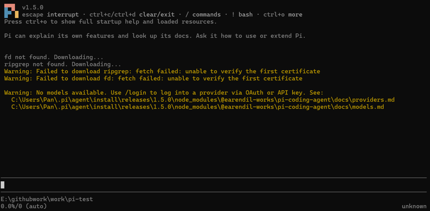

## 任务二：配置DeepSeek模型并完成基础会话
在Pi内输入`/login`选择API Key方式登录DeepSeek。发送hello完成基础对话，验证模型连通可用。

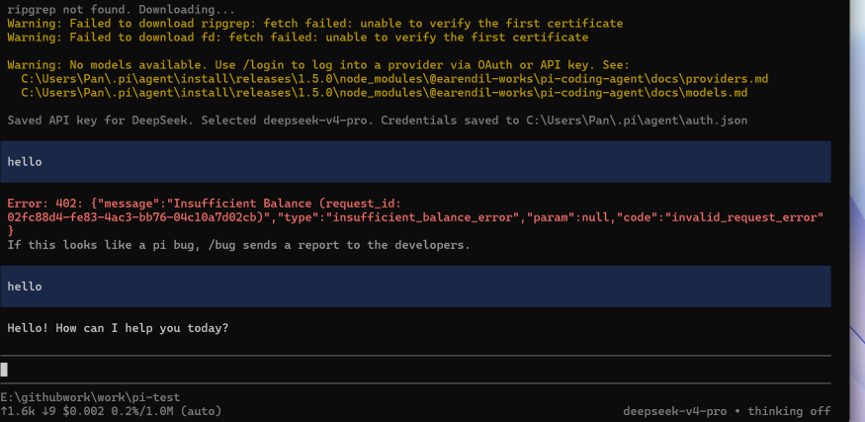

## 任务三：切换模型和模型思考级别
模型切换：由`deepseek‑v4‑pro`切换为`deepseek‑flash`，发送测试提问验证会话正常。
思考级别切换：
- off：No reasoning，不启用内部推理，速度快，适合简单问答
- low：Light reasoning，轻量推理，消耗更多token，适合简单逻辑任务

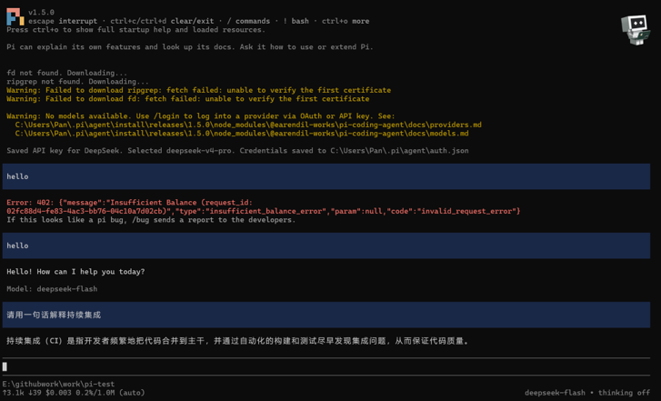
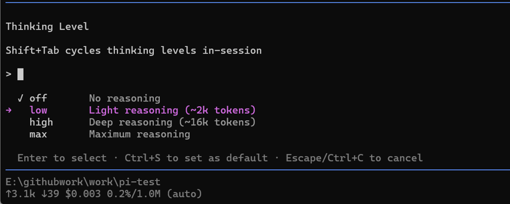
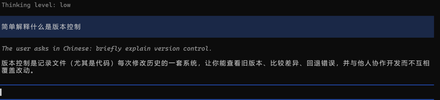

## 任务四：@引用代码文件 + 粘贴图片测试
### 4.A 使用@引用本地代码文件
项目目录创建hello.py，使用`@hello.py`引用该文件，提示AI解析代码功能与运行输出，AI成功读取本地文件并给出结果。

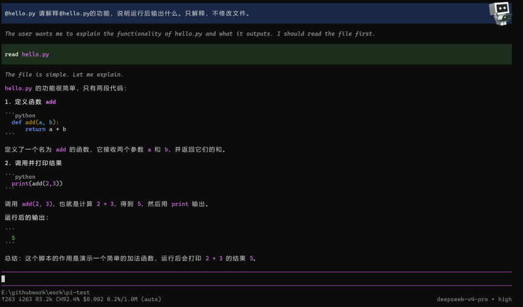

### 4.B 粘贴图片进行识别测试
准备211×211像素测试图片，剪贴板粘贴输入Pi。本机缺少Sixel PowerShell模块，终端无法预览图片，但是模型依旧成功识别图片颜色、形状、数字。

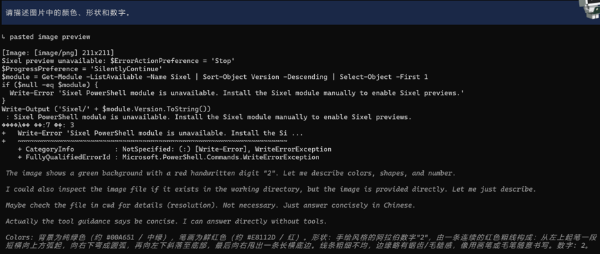
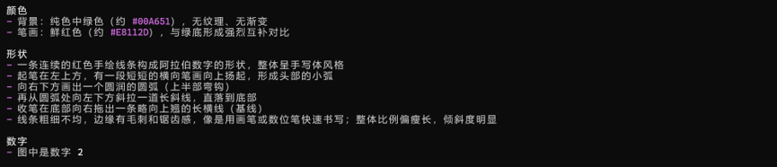

## 任务五：安装pi‑web‑access网页抓取插件
本地项目局部安装插件命令：
pi install npm:pi-web-access -l --approve

执行安装完毕后退出当前Pi会话，重新启动Pi，在启动日志的[Extensions]区块查看，确认pi‑web‑access:dist扩展已经加载。
向Pi下达指令访问example.com，调用fetch网页抓取能力，成功获取网页源码并解析出页面标题Example Domain，验证扩展加载正常，网页抓取功能可正常使用。

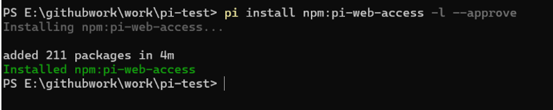
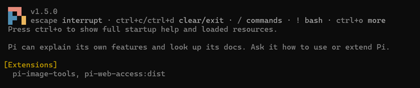
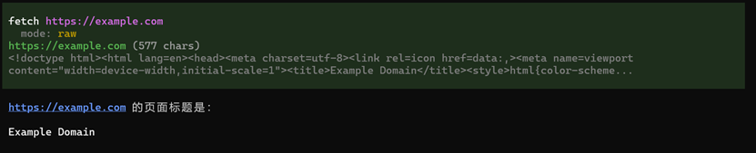

## 任务六：部署pptx Skill（选做）
向Pi发送提示，从 https://github.com/anthropics/skills 下载skills/pptx完整目录，部署到当前项目路径.pi/skills/pptx，完整保留SKILL.md、LICENSE.txt、scripts目录下全部脚本文件。
文件部署完成，完全退出终端会话，重新运行pi启动程序，Pi会自动扫描并识别pptx技能。执行skill调用指令：
/skill:pptx 请说明这个 Skill 的名称、用途和所在目录

调用后成功解析Skill文档，输出该技能用途以及本地存放路径，完成Skill加载、调用全流程验证。

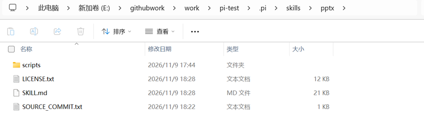
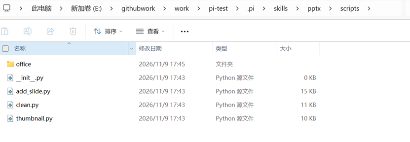
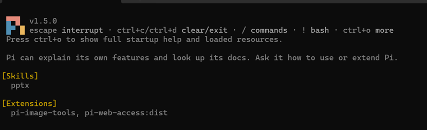
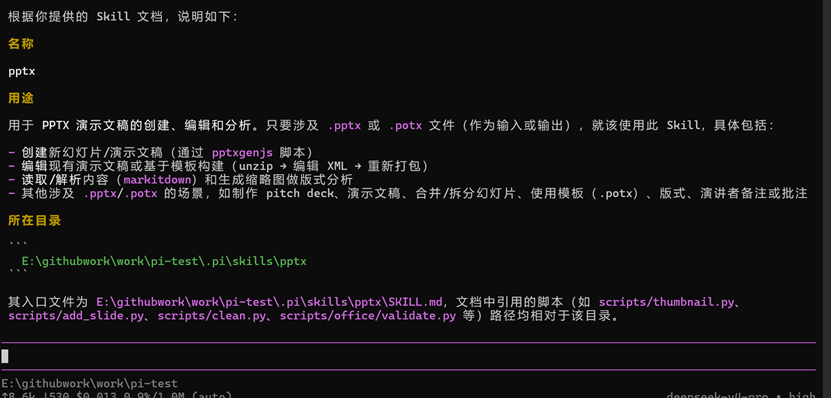

## 实验小结
本次实践完成全部实验任务，掌握Pi Agent启动登录流程、模型切换、思考级别调节；熟悉本地文件引用、图片多模态输入的交互方式；分清Extension插件与Skill技能二者的区别以及各自部署方式，理解Pi Agent“本地客户端 + 远端大模型API”的整体运行架构。
